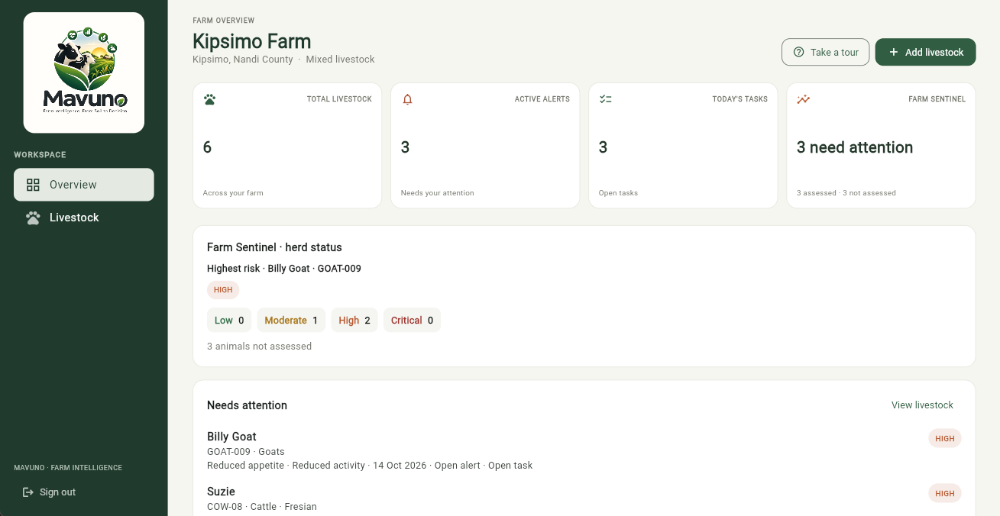
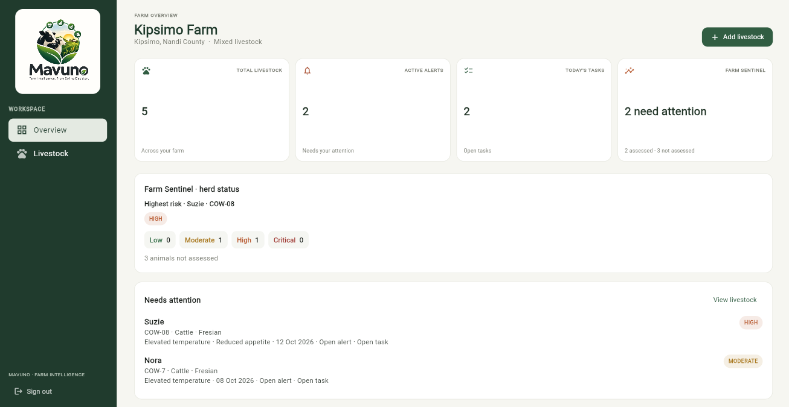
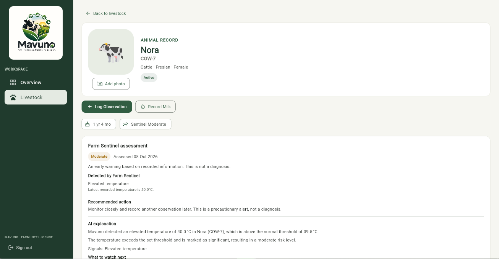
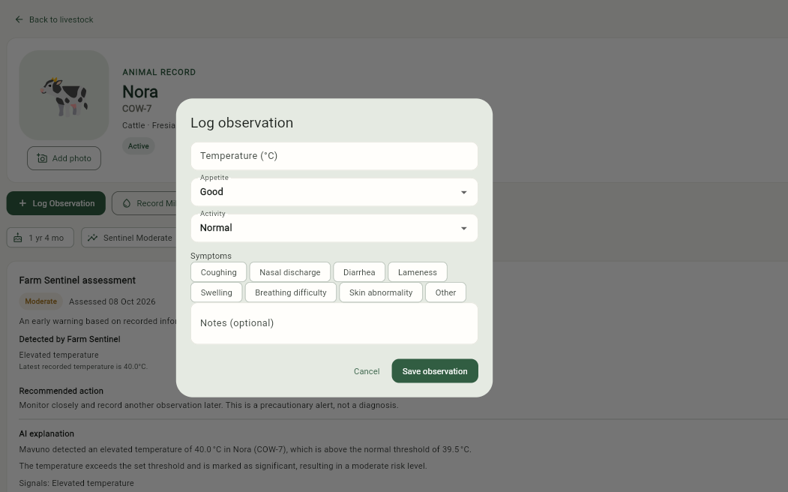
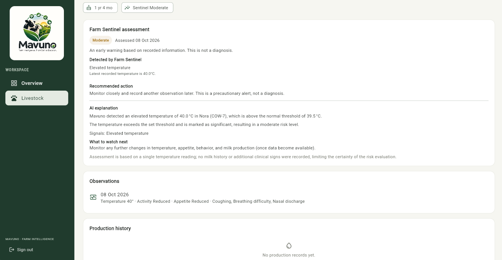
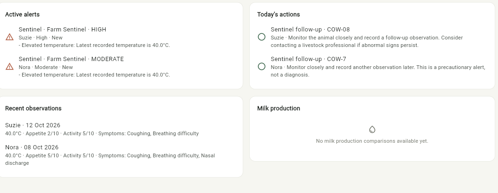
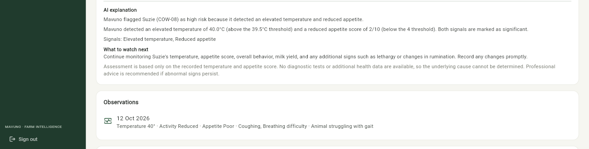
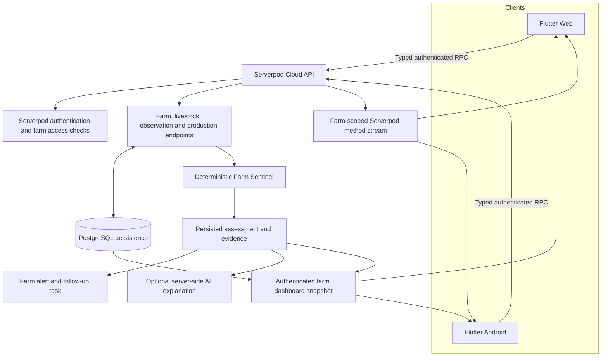

# 🌾 Mavuno  Farm Intelligence & Early Warning Platform

>  
>***Mavuno** (Translates to Harvest in Swahili) is a farm-management and early-warning application for smallholder livestock farmers. It brings farm records, livestock observations, deterministic Farm Sentinel assessments, alerts, and follow-up tasks into one authenticated Flutter app backed by Serverpod*

**Farm intelligence, from soil to decision.**

[](https://flutter.dev/)
[](https://dart.dev/)
[](https://serverpod.dev/)
[](https://www.postgresql.org/)
[](LICENSE)

Mavuno is a farm management and livestock early-warning app for smallholder farmers. It brings farm and animal records, field observations, milk production, alerts, and follow-up tasks into one responsive application for web and Android.

Mavuno is built with Flutter and Serverpod. Its backend authenticates users, enforces farm ownership, and persists farm data in PostgreSQL. The app is designed for smallholder livestock farming in East Africa.




## Try Mavuno

| Platform | Link |
| --- | --- |
| Web application | [Open Mavuno](https://mavuno.serverpod.space/) |
| Android | [Download Mavuno v1.0.1 APK](https://github.com/gethsun1/mavuno/releases/download/v1.0.1/mavuno-android-v1.0.1.apk) |
| Release notes | [Mavuno v1.0.1 — Android Release](https://github.com/gethsun1/mavuno/releases/tag/v1.0.1) |
| Production API | [mavuno.api.serverpod.space](https://mavuno.api.serverpod.space/) |

The Android release is an APK for Android 7.0 (API 24) and later. Its application ID is `com.mavuno.farm` and its version is `1.0.1+2`.

## The Product

Screens from the Mavuno app. The same workflows are available on web and Android.

| Farm dashboard | Animal profile |
| --- | --- |
|  |  |

| Record an observation | Sentinel assessment |
| --- | --- |
|  |  |

| Alert and follow-up task | Optional AI explanation |
| --- | --- |
|  |  |

## What Mavuno does

- Supports account sign-in, farm onboarding, and farm management.
- Lets farmers register livestock, browse animals, and maintain animal profiles, including photos.
- Stores structured observations temperature, appetite, activity, symptoms, and notes separately from milk production records.
- Uses **Farm Sentinel**, a deterministic rules engine, to assess recorded signals and save the evidence and recommended follow-up.
- Organizes farm alerts and follow-up tasks, with a dashboard for current farm activity.
- Delivers farm-scoped realtime events so connected clients can refresh after records change.
- Can provide an optional server-side AI explanation of a saved Sentinel assessment.

## Farm Sentinel

Sentinel evaluates persisted records on the server. Current rules look for temperature at or above 39.5 °C, appetite or activity at or below 4/10, and a milk-production decline of at least 20% between the latest two compatible records. The number of detected signals determines a Low, Moderate, High, or Critical assessment. Milk comparisons require matching units and an earlier value above zero.

Assessments include their detected signals, supporting evidence, and a suggested next action. Sentinel is an explainable early-warning tool, not a diagnosis or a substitute for veterinary care. When there is no assessment, Mavuno shows **Not assessed** rather than estimating a risk level. Rules and thresholds are product logic, not universal clinical guidance.

AI is optional and only explains an assessment already persisted by the server. It does not select the risk level or replace the assessment evidence. If the AI provider is unavailable, farm records and Sentinel results remain available.


## Realtime updates

After a record and its Sentinel updates are persisted, the server publishes a farm-scoped change event. Authenticated clients subscribe through a Serverpod method stream and reload the dashboard snapshot when an event arrives.

```text
Observation saved → Sentinel evaluates → Assessment, alert and task persisted
     → Farm-scoped realtime event → Client refreshes authoritative dashboard
```

Realtime is the delivery mechanism, not the source of truth. Persisted Serverpod/PostgreSQL state remains authoritative; reconnecting clients reload their snapshot.

## Architecture

```text
Flutter Web / Android
        ↓
Serverpod typed client and authenticated endpoints
        ↓
Farm domain and server-side ownership checks
        ↓
PostgreSQL persisted farm records
        ↓
Deterministic Farm Sentinel
        ↓
Persisted assessments → Alerts / Tasks
        ↓
Serverpod realtime events → Dashboard refresh

Optional: persisted Sentinel assessment → server-side AI explanation
```

Farm Sentinel is authoritative for the assessment and recommendation. AI receives persisted evidence to explain; it cannot replace the facts or determine the risk level.



Both clients use the same production backend. Serverpod provides authenticated typed endpoints, generated client/server protocol, PostgreSQL persistence, server-side domain logic and realtime method streams. The deployed application and API run on Serverpod Cloud.

## Technology

| Area | Technology |
| --- | --- |
| Clients | Flutter, Dart, Flutter Web, Android |
| Backend | Serverpod 4.0.0, Dart, authenticated typed endpoints |
| Persistence | PostgreSQL through Serverpod |
| Realtime | Serverpod method streams / MessageCentral |
| AI explanations | Server-side Groq chat completions integration; configured default model `openai/gpt-oss-120b` |
| Deployment | Serverpod Cloud |

## Run locally

Requirements: Flutter 3.44.4 (or compatible Flutter 3.x), Dart 3.12.2 (or compatible), and Serverpod CLI 4.0.0.

```bash
git clone https://github.com/gethsun1/mavuno.git
cd mavuno
dart pub global activate serverpod_cli 4.0.0
dart pub get
cd mavuno_server
serverpod start
```

`serverpod start` starts the backend and configured Flutter app and watches for code changes. Local configuration and database data live under `mavuno_server/config/` and `mavuno_server/.serverpod/`; keep credentials out of tracked files.

## Project layout

```text
mavuno/
├── mavuno_flutter/   # Flutter app and widget tests
├── mavuno_server/    # Serverpod endpoints, domain logic, and tests
├── mavuno_client/    # Generated Serverpod client protocol
├── mavuno_lms_sim/   # Standalone simulated livestock monitoring system
└── docs/screenshots/ # Product screenshots
```

`mavuno_lms_sim` is a development simulator that sends sample livestock behaviour observations to a local Mavuno server. It is a prototype for a planned IoT capability: connecting real monitoring devices to provide farmers with timely livestock activity and progress updates, and to support theft deterrence. Real device monitoring and theft prevention are not current app features.

Serverpod-generated files are maintained by the generator. Make server model and endpoint changes in their source files, not in generated output.

## License

Mavuno is open source under the [MIT License](LICENSE).

***Built with ❤️ for the Serverpod Hackathon.***
